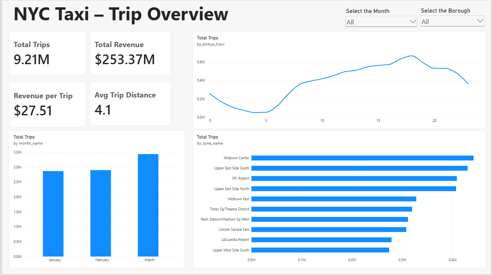
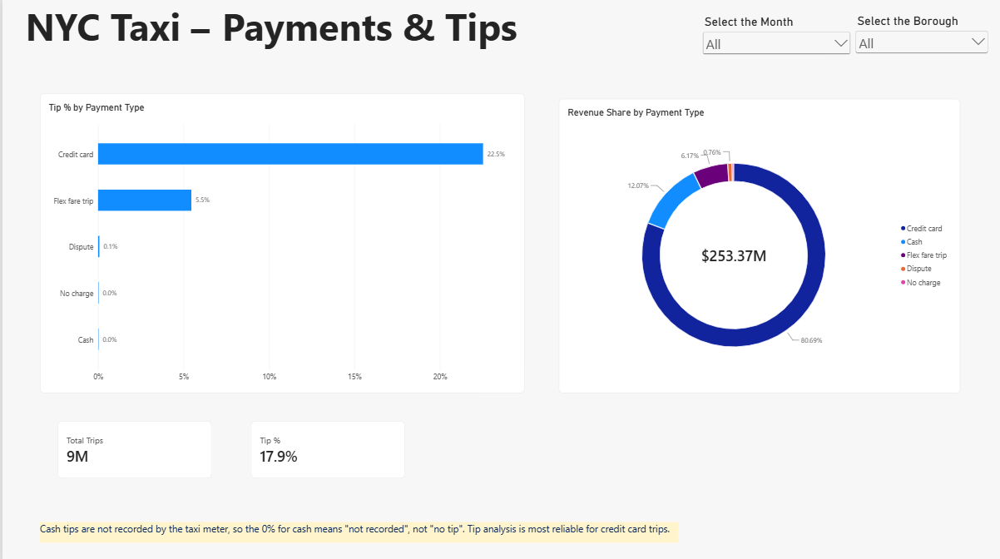
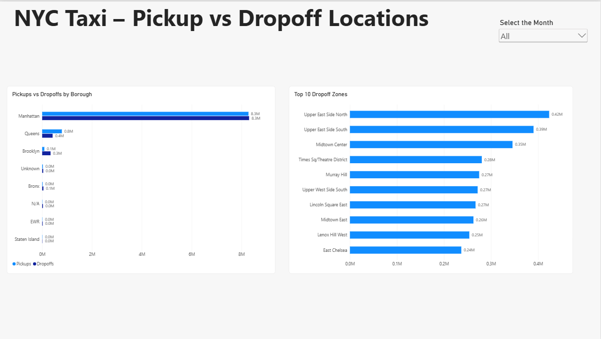

# NYC Taxi Data Warehouse

An end-to-end data warehouse project built as a solo learning project: raw NYC Yellow Taxi Parquet files are cleaned with **PySpark**, loaded into a **SQL Server** star schema, and reported on with a three-page **Power BI** dashboard.

**Author:** Hasanthi Chamoda | [GitHub](https://github.com/Hasanthii)

## Dashboard preview





## Tech stack

| Tool | Used for |
|---|---|
| Parquet | Source data (TLC Yellow Taxi trip records, Jan to Mar 2024) |
| PySpark | Cleaning, validation, loading into SQL Server |
| SQL Server | Staging layer and star schema |
| Power BI | Data model, DAX measures, dashboards |
| GitHub | Version control and documentation |

## Architecture

```
Parquet files (data/raw)
      |  PySpark: clean, add columns, split good and rejected rows
      v
Clean and rejected Parquet (data/clean, data/rejected)
      |  PySpark (JDBC): load stg_trip
      v
stg_trip (SQL Server staging table)
      |  Stored procedure usp_load_fact_trip (checks + one transaction)
      v
fact_trip + dimension tables (star schema)
      |
      v
Power BI model, DAX measures, 3-page dashboard
```

## Star schema

**Grain:** one row in `fact_trip` = one taxi trip.

- **Fact table:** `fact_trip` (keys, pickup and dropoff times, distance, duration, fare, tip, tolls, taxes, total)
- **Dimensions:** `dim_date`, `dim_vendor`, `dim_rate_code`, `dim_payment_type`, `dim_location`
- `dim_location` is a **role-playing dimension**: it is used for both pickup and dropoff.

Details: [docs/star_schema.md](docs/star_schema.md)

## ETL pipeline

`scripts/etl_pipeline.py` loads files **incrementally**:

1. Reads `etl_file_log` to see which files already loaded successfully
2. Finds new Parquet files in `data/raw`
3. For each new file: cleans it, loads `stg_trip`, then calls `usp_load_fact_trip`
4. Records the result (row counts, status, error message) in `etl_file_log`

**Safe to re-run:** running the pipeline with no new files changes nothing. The stored procedure also refuses to load a file that is already marked SUCCESS, and loads the fact rows and the log row in one transaction (all or nothing).

## Data quality

Rows are rejected (and saved separately, with a reason) if the dropoff is before the pickup, the pickup is outside the file's month, or distance, fare or total amount is zero or negative. Rows with missing values are kept and fixed (for example, a missing rate code becomes 99, "unknown"). Full rules: [docs/data_quality_rules.md](docs/data_quality_rules.md)

| File | Raw rows | Clean | Rejected |
|---|---|---|---|
| 2024-01 | 2,964,624 | 2,869,641 | 94,983 |
| 2024-02 | 3,007,526 | 2,901,452 | 106,074 |
| 2024-03 | see log | 3,439,925 | see log |

`sql/09_validation_checks.sql` runs seven checks on the warehouse. All return 0 failures.

## Power BI model and DAX

- One-to-many relationships from each dimension to `fact_trip`, with single-direction filtering
- `dim_date` marked as the date table; Auto date/time turned off
- Pickup location is the active relationship; dropoff is inactive and used through `USERELATIONSHIP`
- Measures: Total Trips, Total Revenue, Revenue per Trip, Avg Trip Distance, Avg Trip Duration (min), Total Tips, Tip %, Dropoff Trips

## Lessons learned

**A time-zone bug that row counts could not catch.** After loading, Power BI showed trips in April even though only January to March files were loaded. Every timestamp had been shifted by +5:30, because the JDBC driver converted the clock times to my computer's time zone (Sri Lanka) on the way in. Row counts and revenue totals were all correct, so the earlier checks passed. I found it by comparing a report to the source, fixed it by running Spark in UTC, reloaded the data, and added validation checks (stored pickup hour vs `pickup_hour`, pickup month vs file name) that would catch it again.

**Other lessons**
- Staging keeps raw loading separate from business rules, so a failed load can be wiped without touching the warehouse.
- Cash tips are not recorded by the taxi meter, so cash shows about 0% tips. The dashboard says so.
- Port 1433 was already used by another SQL Server instance, so this instance runs on port 1435.

## How to run

**Requirements:** Windows, SQL Server, Python 3.9+, Java 17+, PySpark, the Microsoft JDBC driver (`drivers/`), and `winutils.exe` with `HADOOP_HOME` set.

1. Create the `NYCTaxiDW` database and a SQL login for the pipeline
2. Set these environment variables: `NYCTAXI_DB_SERVER` (for example `localhost:1435`), `NYCTAXI_DB_USER`, `NYCTAXI_DB_PASSWORD`
3. Run the SQL files in `sql/` in this order: `01`, `02`, `03`, `04`, `05`, `07`, `08`
4. Run `python scripts/04_load_dim_location.py` (needs `data/reference/taxi_zone_lookup.csv`)
5. Put Parquet files in `data/raw/` and run `python scripts/etl_pipeline.py`
6. Run `sql/09_validation_checks.sql` (every check should return 0)

## Repository layout

```
scripts/   PySpark scripts (01-07 are the build-up steps, etl_pipeline.py is the final pipeline)
sql/       Table definitions, dimension loads, stored procedure, validation checks
docs/      Star schema, data quality rules, dashboard screenshots
```

Data files, the JDBC driver and the `.pbix` file are not in the repository (too large).

## Data source

[NYC TLC Trip Record Data](https://www.nyc.gov/site/tlc/about/tlc-trip-record-data.page)
